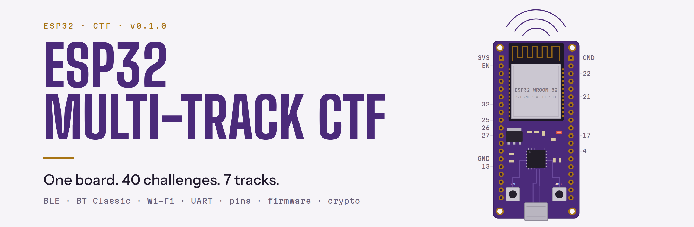
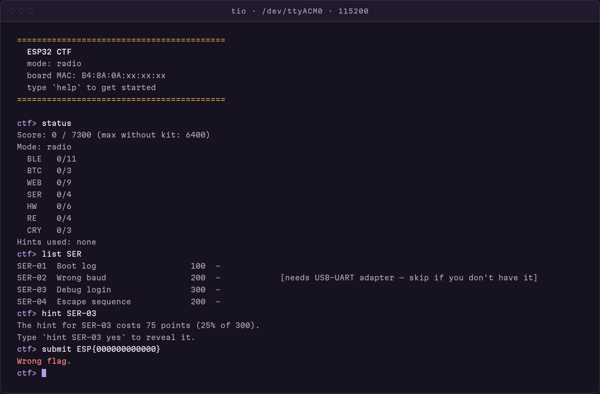
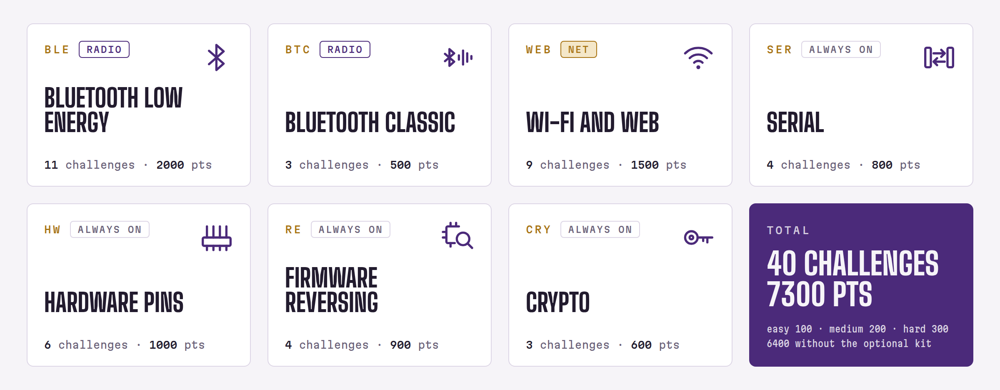
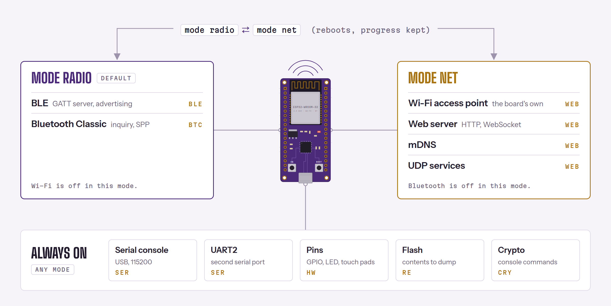
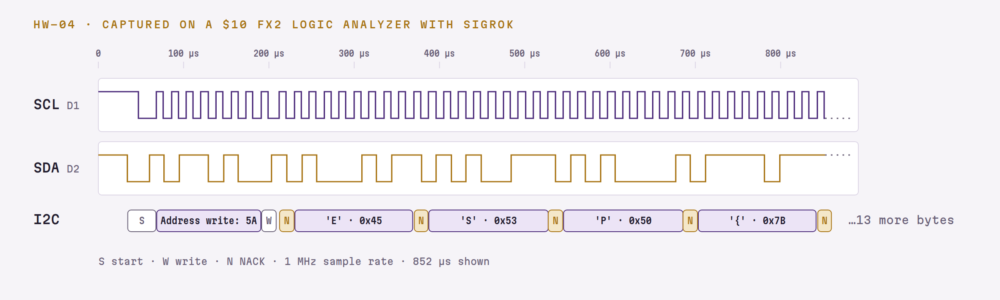

<p align="center">
  <picture>
    <source media="(prefers-color-scheme: dark)" srcset="docs/img/banner-dark.png">
    
  </picture>
</p>

<p align="center">
  <a href="https://github.com/HDElectronics/esp32-ctf/releases/latest"></a>
  <a href="LICENSE"></a>
  
  
  
</p>

Flash one classic ESP32 DevKit and play a self-contained capture-the-flag across
seven tracks, from Bluetooth to firmware reversing. 40 challenges from easy to hard,
scored on the board itself, with per-board flags and built-in hints that cost points.
Inspired by [hackgnar/ble_ctf](https://github.com/hackgnar/ble_ctf), broader in scope.

<p align="center">
  
</p>

## Quick start

1. Download `esp32-ctf-v0.1.0.bin` from the [latest release](https://github.com/HDElectronics/esp32-ctf/releases/latest).
2. Flash it with `esptool` (`pipx install esptool`); flashing again wipes your progress.
3. Open the console at 115200 8N1, press EN/RST, then type `help`, `status` and `list`.

```sh
# merged image (bootloader + partition table + app) at offset 0x0;
# the port may be /dev/ttyACM0, COM3 or /dev/cu.usbserial-*
esptool --chip esp32 -p /dev/ttyUSB0 write-flash 0x0 esp32-ctf-v0.1.0.bin
tio -b 115200 /dev/ttyUSB0
```

## Tracks

<picture>
  <source media="(prefers-color-scheme: dark)" srcset="docs/img/tracks-dark.png">
  
</picture>

Pick a track and read its spoiler-free guide in [docs/players/](docs/players/index.md).

## How it works

The classic ESP32 doesn't have the RAM to run Wi-Fi, BLE and Bluetooth Classic at
once, so the radios are split into two modes. `mode radio` / `mode net` saves the
choice and reboots, progress is kept; `mode` alone shows the current one.

<picture>
  <source media="(prefers-color-scheme: dark)" srcset="docs/img/modes-dark.png">
  
</picture>

- **Flags are unique per board** (derived from its MAC) and look like `ESP{0123456789AB}`; a few challenges take `answer <id> <value>` instead.
- **Hints cost 25%** of a challenge's points: `hint <id>` shows the cost, `hint <id> yes` reveals it.
- **Submit anywhere:** `submit <flag>` on the console, over BLE in radio mode (CTF control service) or on the board's `/submit` page in net mode; any interface accepts any challenge's flag.
- **Optional-kit challenges can be skipped:** max 7300 points, 6400 without the kit.

## Hardware

- **Required:** a classic ESP32 DevKit with 4 MB flash (ESP32-DevKitC, DOIT DevKit v1 38-pin or similar; not S2/S3/C3/C6), a USB cable, a laptop (Linux is easiest for the Bluetooth tracks) and a phone.
- **Optional kit** (5 challenges, 900 points): a logic analyzer such as a cheap 8-channel 24 MHz FX2 clone that works with sigrok (HW-03, HW-04, HW-05), a 3.3 V USB-UART adapter (SER-02), one jumper wire (HW-01). `status` and `list` mark these.

<picture>
  <source media="(prefers-color-scheme: dark)" srcset="docs/img/i2c-dark.png">
  
</picture>

## Toolbox

**Serial** `tio` · **BLE / BT Classic** `bluetoothctl`, `bleak` · **Web** `curl` ·
**Hardware** `sigrok-cli` · **Firmware RE** `esptool`, Ghidra · **Crypto** CyberChef.
Every tool per track, with install commands: [docs/toolbox.md](docs/toolbox.md).

## Organizers & contributors

- [docs/development.md](docs/development.md): build from source, host tests, dev options (and why a dev image must never reach a player), release script, resetting boards.
- [solvers/README.md](solvers/README.md): one reference solver per challenge (full spoilers).
- [docs/SPEC.md](docs/SPEC.md): design and every challenge's mechanism (spoilers).
- [docs/PLAN.md](docs/PLAN.md): plan and status.

## Scope

Every challenge targets the board and nothing else; keep your tools pointed at your own board ([details](docs/players/index.md#scope)).

## License

[MIT](LICENSE). Built on ESP-IDF (Apache-2.0) and the espressif/mdns component (Apache-2.0).
