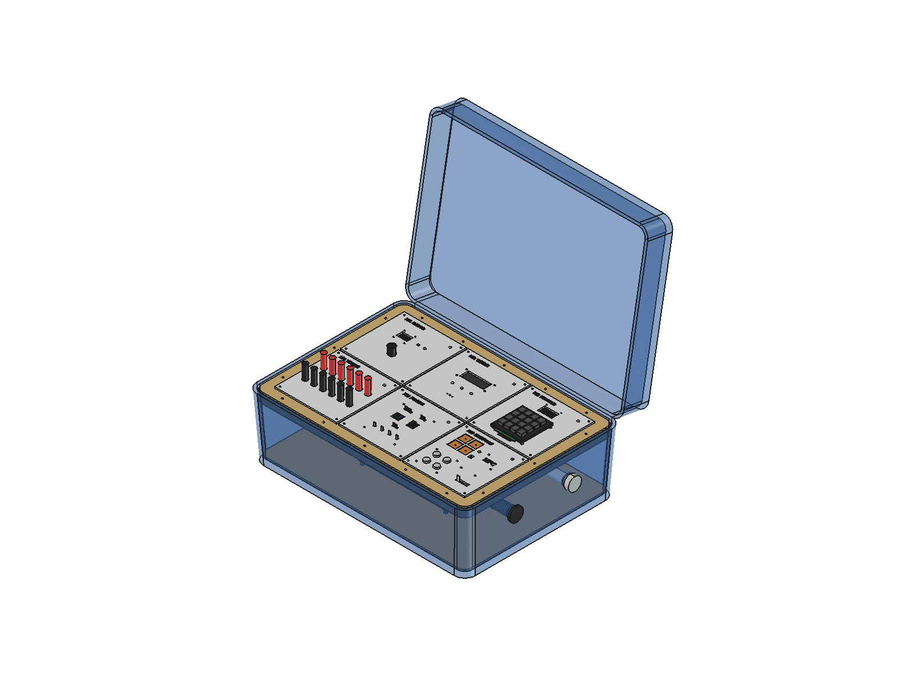
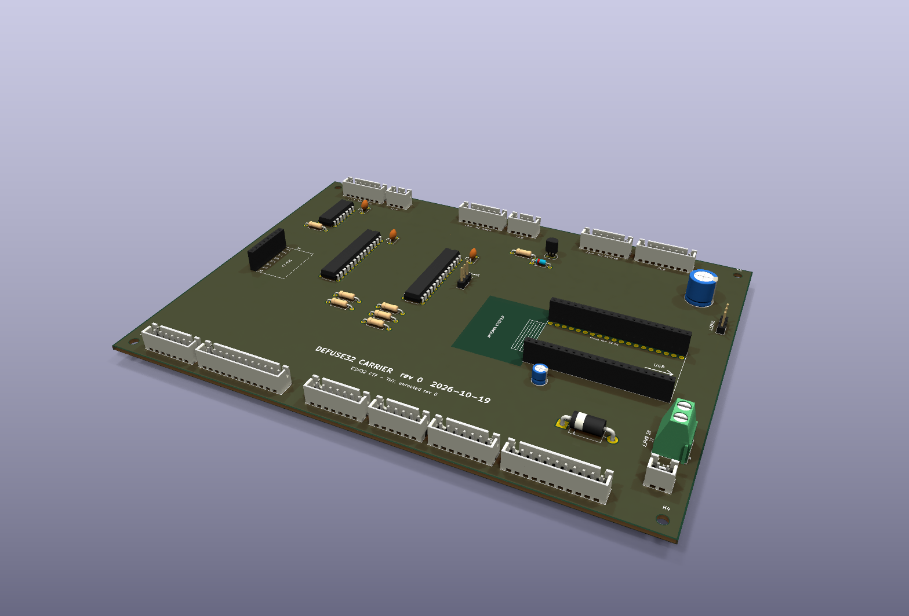
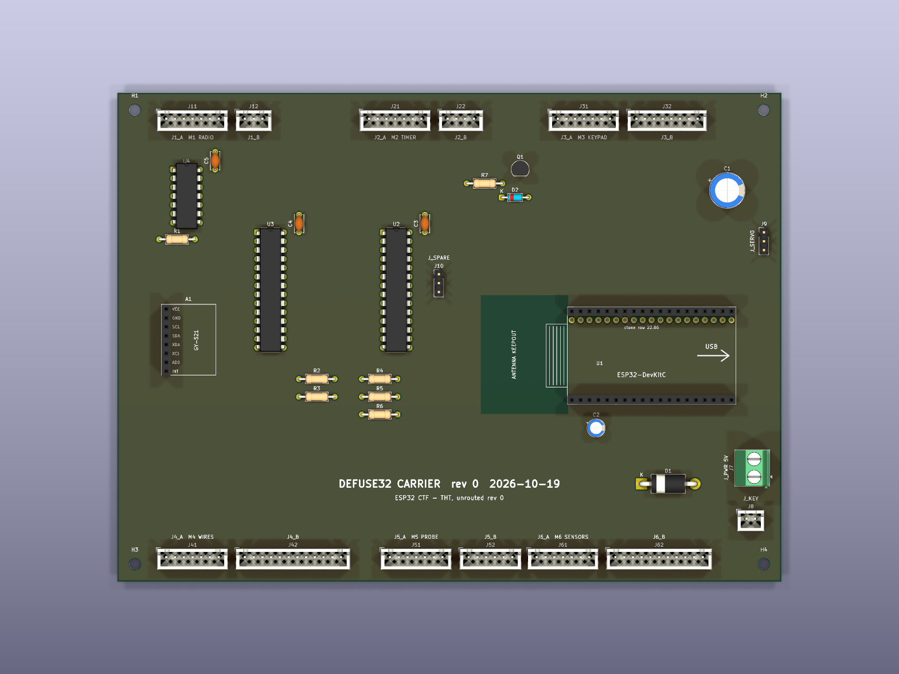

# Defuse32 hardware (rev 0)

Defuse32 is a "defuse the bomb" CTF case for the ESP32 CTF firmware. It is a Pelican 1520 hard case with a laser-cut panel holding six module plates (Radio, Timer, Keypad, Wires, Probe, Sensors). Each plate carries off-the-shelf breakout modules that hide CTF challenges. A THT carrier PCB on the case floor holds an ESP32-DevKitC, two MCP23017 expanders and the JST-XH harness connectors to the plates. Nothing here is drawn by hand: KiCad and FreeCAD outputs are generated by scripts from [`SPEC.md`](SPEC.md) and [`data/parts.json`](data/parts.json).

## Renders

| | |
|---|---|
|  |  |
| Case with the lid open (FreeCAD) | Exploded: frame, panel and plates lifted off the carrier |
|  |  |
| Top view of the six plates | Carrier PCB with parts (KiCad, unrouted) |
|  | |
| Carrier PCB, top (KiCad) | |

## Bill of materials (summary)

| Group | Parts | Price |
|---|---|---|
| Case + frame kit | Pelican 1520NF (empty) + 1520PF panel frame kit | US$168-218 + US$31.95 ([`docs/parts.md`](docs/parts.md)) |
| Panel and plates | 452 x 321 x 3 panel + 6 plates 134 x 138 x 3 (acrylic or ply), M3 hardware | material only |
| Modules on plates | SSD1306 0.96" and SH1106 1.3" OLEDs, KY-040 encoder, TM1637 0.56" display, 4x4 hard-key keypad, 12 banana posts + 6 leads, PN532 V3, GL5528 LDR, VS1838B IR, 4 x 12 mm tact buttons, SG90 servo, 12 mm passive buzzer, ~15 WS2812, 24C32 + W25Q32 on the probe plate | not priced yet |
| Case wall | 19 mm key switch, panel-mount USB-C 5 V input | not priced yet |
| Carrier PCB ([`kicad/out/bom.csv`](kicad/out/bom.csv)) | ESP32-DevKitC-32E (socketed), 2 x MCP23017-E/SP, 74AHCT125, GY-521, 2N3904, 1N5822, 1N4148, 470 µF + 10 µF + 3 x 100 nF, 7 resistors, 13 JST-XH headers (2-12 pin), 2 x 1x3 pin headers, 2-pin screw terminal | not priced yet |

Rough total: only the case and frame are priced in the sources, **about US$200-250** for those alone. Modules, carrier parts and the PCB order still need a priced BOM.

## Regenerate

KiCad (from `hardware/defuse32/kicad/`; KiCad Python is `/usr/bin/python3`, not conda). Full export list in [`kicad/README.md`](kicad/README.md).

```sh
/usr/bin/python3 gen/gen_lib.py && kicad-cli sym upgrade --force defuse32.kicad_sym && kicad-cli fp upgrade --force defuse32.pretty
/usr/bin/python3 gen/gen_sch.py
/usr/bin/python3 gen/gen_pcb.py
kicad-cli sch erc --severity-all -o out/erc.rpt defuse32-carrier.kicad_sch
kicad-cli pcb drc --schematic-parity --severity-all -o out/drc.rpt defuse32-carrier.kicad_pcb
/usr/bin/python3 gen/check_netlist.py out/defuse32-carrier.net defuse32-carrier.kicad_pcb
kicad-cli pcb export step --force --subst-models -o ../cad/carrier.step defuse32-carrier.kicad_pcb
```

FreeCAD (from `hardware/defuse32/`, after the KiCad step so it imports the real `cad/carrier.step`):

```sh
freecad.cmd cad/build.py          # ~20 s: FCStd, DXF, STL, STEP, GLB, fit checks, renders/cad_*.png
D32_STRICT=1 freecad.cmd cad/build.py   # exit 1 if a fit check fails
```

Options and outputs: [`cad/README.md`](cad/README.md). `design.py` is the source of truth for the carrier; `layout.py` for the plates.

## What to fabricate

- **Laser cut, 3 mm acrylic or plywood** (not metal: it shields the DevKit antenna and the PN532): `cad/out/panel.dxf` and `cad/out/plate_M1.dxf` to `plate_M6.dxf`. 1:1 mm, layer `CUT` for through-cuts, `ENGRAVE_1MM` for titles and touch-pad recesses.
- **3D print instead** (PLA/PETG): `cad/out/panel.stl`, `cad/out/plate_M1.stl` to `plate_M6.stl` (engravings included).
- **Carrier PCB gerbers: not yet.** The board is placed but unrouted.
- Everything else is bought: the case, the 1520PF frame and the modules.

## Before cutting

Values marked T (typical) in [`docs/parts.md`](docs/parts.md) must be measured on the parts you receive. The ones that move holes:

- **Case:** 1520 interior corner radius and floor size (R16.5 and 445 x 314 assumed); 1520PF frame section and insert thread; test-fit the 452 x 321 panel; pick a flat wall spot for the key switch and USB-C.
- **SSD1306:** window vertical position (±1.5 mm) and hole pitch (batches vary).
- **SH1106:** hole pattern (31.5 x 28.7 assumed; sellers also use 30.5 x 29 or 30 x 28).
- **TM1637 0.56":** hole centres and display position (scaled from a photo).
- **KY-040:** shaft position and body height (sets the gap under the plate).
- **Keypad:** hole diameter, tail header position (sets the 27.4 x 6 cable slot), frame and key heights, spacer height (3 mm).
- **PN532:** hole positions (scaled from a photo).
- **SG90:** ear-hole spacing and horn length (sets the latch slot).
- **Banana posts, key switch, USB-C:** hole diameters and depths of the parts actually bought.
- **Proposals in `cad/layout.py`:** perfboard sizes, tact-cap hole (depends on the caps), test-point hole, header slot clearance.
- **DevKit:** buy a genuine DevKitC (25.40 mm rows) or use the clone row (22.86 mm).

## Status / next

- Done: SPEC, parts research, carrier schematic (ERC clean), placed board (DRC 0 violations, 0 parity issues, 140 unconnected), netlist check OK; FreeCAD assembly with the real carrier STEP, all fit checks pass, laser/print files.
- Next: **route the carrier.** No autorouter is installed here; either install Freerouting (export DSN, import SES) or route by hand (5V/GND first, then I2C). Join the clone-row pads, refill zones, rerun DRC, then make gerbers and drill files.
- Then: settle the open questions in [`kicad/README.md`](kicad/README.md) (servo pin order), measure the T values, cut a test plate, and write the plate firmware.
