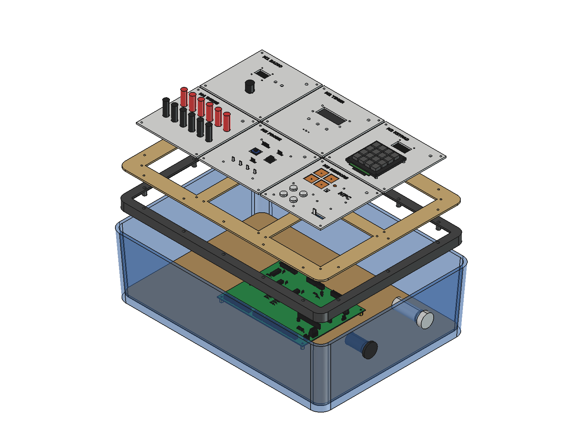
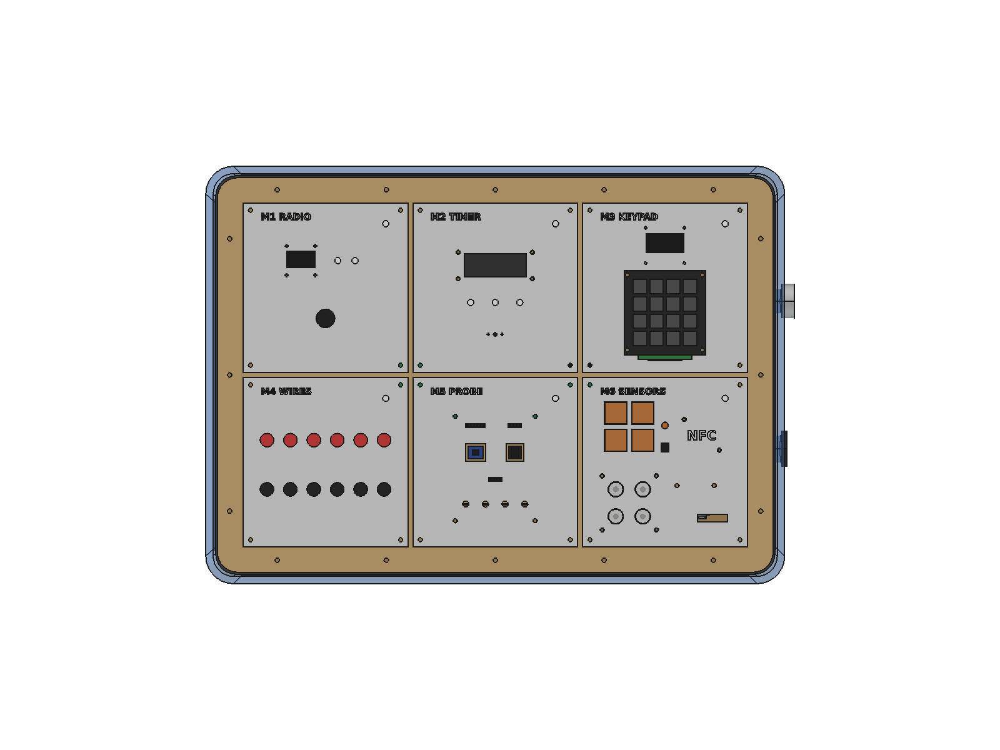
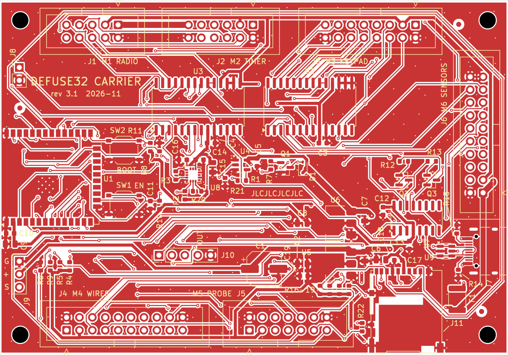

# Defuse32 hardware

Defuse32 is a hardware CTF training case for the ESP32 CTF project: a team finds a code on each module to disarm it against a timer, then pulls the right wire to win the round. It is a Pelican 1520 hard case with a laser-cut panel holding six module plates (Radio, Timer, Keypad, Wires, Probe, Sensors). Each plate carries off-the-shelf breakout modules that hide the challenges. One custom board, the **carrier PCB** (100 x 70 mm, 4 layers, assembled by JLCPCB), sits on the case floor: an ESP32-WROOM-32E, USB-C with a CH340C, two MCP23017 expanders, a LIS3DH tilt sensor, a microSD slot and one ribbon-cable header per plate. Nothing here is drawn by hand: the KiCad and FreeCAD outputs are generated by scripts from [`SPEC.md`](SPEC.md) and [`data/parts.json`](data/parts.json).

Current revision: **carrier board rev 3.1, schematic rev 2.1** (2026-11-25, after a standards pass; record in [`kicad/README.md`](kicad/README.md)). Firmware v0 builds and passes its host tests; it has not run on hardware yet ([`firmware/README.md`](firmware/README.md)).

## Renders

| | |
|---|---|
|  |  |
| Case with the lid open (FreeCAD) | Exploded: frame, panel and plates lifted off the carrier |
|  |  |
| Top view of the six plates | Carrier PCB rev 3.1 with parts (KiCad) |
|  |  |
| Carrier PCB, top (KiCad) | Top copper layer |

More carrier plots: `renders/carrier-bottom.png`, `carrier-b-cu.png`, `carrier-in1-cu.png`, `carrier-in2-cu.png`, `carrier-silk.png`.

## Bill of materials (summary)

| Group | Parts | Where |
|---|---|---|
| Case + frame kit | Pelican 1520NF (empty) + 1520PF panel frame kit | [`docs/parts.md`](docs/parts.md) |
| Panel and plates | 452 x 321 x 3 panel + 6 plates 134 x 138 x 3 (acrylic or ply), M3 hardware | `cad/out/*.dxf`, `*.stl` |
| Modules on plates | SSD1306 0.96" and SH1106 1.3" OLEDs, KY-040 encoder, TM1637 0.56" display, 4x4 hard-key keypad, 12 banana posts + 6 leads, PN532 V3, GL5528 LDR, VS1838B IR, 4 x 12 mm tact buttons, SG90 servo, 12 mm passive buzzer (32 Ω or higher preferred), 15 WS2812, 24C32 + W25Q32 on the probe plate | [`SPEC.md`](SPEC.md) |
| Case wall | 19 mm key switch, panel-mount USB-C extension | [`SPEC.md`](SPEC.md) |
| Carrier PCB, SMD (assembled by JLCPCB) | ESP32-WROOM-32E-N4, CH340C, 2 x MCP23017-E/SO, LIS3DHTR, 2 x AMS1117-3.3, 74AHCT1G125, USBLC6-2SC6, SS8050 + 2 x MMBT3904, USB-C, microSD socket, PTC fuse, passives | [`kicad/out/jlcpcb/`](kicad/out/jlcpcb/) (BOM, placement file, LCSC numbers) |
| Carrier PCB, through-hole (soldered by hand) | six keyed 2.54 mm IDC box headers (2x5 to 2x10), three pin headers | [`kicad/out/jlcpcb/README.md`](kicad/out/jlcpcb/README.md) |

## Ordering the carrier

The JLCPCB package is in [`kicad/out/jlcpcb/`](kicad/out/jlcpcb/): Gerber zip, assembly BOM and placement file. Its README has the order settings (4 layers, stack-up JLC04161H-7628, **Standard** PCBA, handling rails on the two long edges), the remark to paste into the order, and the list of parts to check in JLCPCB's placement preview. The preview is the only place where each part's orientation can be confirmed: check it before paying.

## Regenerate

KiCad (from `hardware/defuse32/kicad/`; KiCad's Python is `/usr/bin/python3`, not conda). The full order, including routing and the finish steps, is in [`kicad/README.md`](kicad/README.md); `gen/gen_pcb.py` refuses to overwrite the routed board.

```sh
/usr/bin/python3 gen/gen_sch.py                      # schematic from gen/design.py
kicad-cli sch erc --severity-all -o out/erc.rpt defuse32-carrier.kicad_sch
kicad-cli pcb drc --schematic-parity --severity-all --refill-zones --all-track-errors -o out/drc.rpt defuse32-carrier.kicad_pcb
/usr/bin/python3 gen/check_netlist.py out/defuse32-carrier.net defuse32-carrier.kicad_pcb
/usr/bin/python3 gen/pcb_audit.py defuse32-carrier.kicad_pcb --json out/audit.json   # finish audit
/usr/bin/python3 gen/gen_jlcpcb.py                   # fabrication and assembly files
/usr/bin/python3 gen/renders.py                      # renders/carrier-*.png
kicad-cli pcb export step --force --subst-models -o ../cad/carrier.step defuse32-carrier.kicad_pcb
```

FreeCAD (from `hardware/defuse32/`, after the KiCad step so it imports the real `cad/carrier.step`):

```sh
freecad.cmd cad/build.py          # ~20 s: FCStd, DXF, STL, STEP, GLB, fit checks, renders/cad_*.png
D32_STRICT=1 freecad.cmd cad/build.py   # exit 1 if a fit check fails
```

Options and outputs: [`cad/README.md`](cad/README.md). `kicad/gen/design.py` is the source of truth for the carrier; `cad/layout.py` for the plates.

## What to fabricate

- **Carrier PCB**: order from [`kicad/out/jlcpcb/`](kicad/out/jlcpcb/) (see "Ordering the carrier").
- **Laser cut, 3 mm acrylic or plywood** (not metal: it shields the antenna and the PN532): `cad/out/panel.dxf` and `cad/out/plate_M1.dxf` to `plate_M6.dxf`. 1:1 mm, layer `CUT` for through-cuts, `ENGRAVE_1MM` for titles and touch-pad recesses.
- **3D print instead** (PLA/PETG): `cad/out/panel.stl`, `cad/out/plate_M1.stl` to `plate_M6.stl` (engravings included).
- Everything else is bought: the case, the 1520PF frame and the modules.

## Before cutting

Values marked T (typical) in [`docs/parts.md`](docs/parts.md) must be measured on the parts you receive. The ones that move holes:

- **Case:** 1520 interior corner radius and floor size (R16.5 and 445 x 314 assumed); 1520PF frame section and insert thread; test-fit the 452 x 321 panel; pick a flat wall spot for the key switch and USB-C.
- **SSD1306:** window vertical position (±1.5 mm) and hole pitch (batches vary).
- **SH1106:** hole pattern (31.5 x 28.7 assumed; sellers also use 30.5 x 29 or 30 x 28).
- **TM1637 0.56":** hole centres and display position (scaled from a photo).
- **KY-040:** shaft position and body height (sets the gap under the plate).
- **Keypad:** hole diameter, tail header position (sets the 27.4 x 6 cable slot), frame and key heights, spacer height (3 mm).
- **PN532:** hole positions (scaled from a photo).
- **SG90:** ear-hole spacing and horn length (sets the latch slot).
- **Banana posts, key switch, USB-C:** hole diameters and depths of the parts actually bought.
- **Proposals in `cad/layout.py`:** perfboard sizes, tact-cap hole (depends on the caps), test-point hole, header slot clearance.

## Building the plates: wiring rules that protect the carrier

- Power the IR receiver, the KY-040 encoder, the TM1637 and both OLEDs from header pin 3 (**3V3P**), never from 5 V: their pull-ups would put 5 V on ESP32 and MCP23017 pins.
- Bring no 5 V to pins players can reach on the probe plate (M5). Add series resistors on the plate: 1 kΩ in U2RX / U2TX, 220-330 Ω in each SPI lead, 510 Ω-1 kΩ in each touch lead, 330 Ω-1 kΩ in the wire-post and keypad leads.
- Servo plug on J9: `G + S` on the silkscreen = GND, 5 V, signal. Lead the J8 and J9 cables away from the antenna end of the ESP32 module.
- The WS2812 chain runs through every plate (header pins 6 and 7): with a plate unplugged, the LEDs after it stay dark. Use a loop-back plug joining pins 6 and 7 on an unused header.
- Supply: 5 V, 2 A or more. A 500 mA PC port may sag when the servo moves.

## Status / next

- Done: SPEC; parts research; carrier schematic rev 2.1 and board rev 3.1 (KiCad ERC, DRC and netlist check clean; standards pass with an independent audit, a review and a final check); JLCPCB package; FreeCAD assembly, fit checks, laser/print files; firmware v0 (builds, host tests pass).
- Not ordered yet: carrier PCBs, panel and plates.
- Next: order the carrier, measure the T values on real parts, cut a test plate, first power-on and bring-up one plate at a time ([`kicad/out/jlcpcb/README.md`](kicad/out/jlcpcb/README.md) has the bring-up notes), then the M1 radio challenge and the PN532 driver in firmware.
